<div align="center">


<a href="https://git.io/typing-svg"></a>

<br/>


### 🧠 Research Assistant With Memory

**Drop URLs. Ask questions across all of them as if they were one document.**

</div>

---

## 📖 About

**Research Assistant With Memory** is an AI-powered knowledge retrieval system designed to transform web pages into a **persistent, searchable knowledge base**. Users can submit URLs, ingest their content, and ask natural-language questions across multiple sources through a Streamlit interface.

The system combines **workflow automation** with **semantic search** and **large language models (Google Gemini)** to generate context-aware answers grounded in retrieved source content. Each answer is designed to include **source URL citations**, with an explicit fallback when the available sources do not contain sufficient information.

Unlike a single-session chatbot, the system **retains previously ingested knowledge**, so users can add new sources over time without losing their existing collection.

> **Core technologies:** `n8n` · `Gemini API (gemini-1.5-flash)` · `ChromaDB` · `Streamlit` · `Python` · `python-dotenv`

```
User → Streamlit UI → n8n Webhook → Chunk + Embed → ChromaDB ⇄ Retriever → Gemini → Cited Answer → UI
```

---

## 🧭 Table of Contents

| # | Section | # | Section |
| :-: | :-- | :-: | :-- |
| 1 | [Original Problem Statement](#-1-original-problem-statement) | 6 | [Project Structure](#-6-project-structure) |
| 2 | [Project Overview](#-2-project-overview) | 7 | [Prerequisites & Environment](#-7-prerequisites--environment-configuration) |
| 3 | [Core Features](#-3-core-features) | 8 | [Installation and Setup](#-8-installation-and-setup) |
| 4 | [System Architecture](#-4-system-architecture) | 9 | [Reliability & Grounding](#-9-reliability-grounding-and-error-handling) |
| 5 | [Technology Stack](#-5-technology-stack) | 10 | [Conclusion](#-10-conclusion) |

---

## 📌 1. Original Problem Statement

> ### *“Drop URLs, ask questions across all of them like they are one document.”*

Build a system where an **n8n webhook** receives URLs, scrapes the HTML content, and chunks and embeds it into **ChromaDB**. A **Streamlit** app lets the user ask natural-language questions across all ingested sources. **Gemini** retrieves relevant chunks and answers with **citations** showing which URL each fact came from. New URLs can be added at any time **without losing prior ones**.

### ✅ Required capabilities

| | Capability | Description |
| :-: | :-- | :-- |
| 📥 | **Automated ingestion** | Accept URLs through an n8n webhook and extract their raw HTML text. |
| 🧬 | **Semantic indexing** | Split extracted text into manageable chunks, generate embeddings, and store them in ChromaDB. |
| 🔎 | **Multi-source question answering** | Answer questions using relevant information retrieved from all previously ingested sources. |
| 🔗 | **Source-grounded responses** | Generate answers using Gemini and include citations that identify the originating URLs. |
| 🛑 | **Explicit fallback** | Return a clear *“Not found in sources”* response when the indexed knowledge does not support an answer. |
| 💾 | **Persistent memory** | Retain previously indexed content across application sessions and support incremental ingestion. |

---

## 🎯 2. Project Overview

Traditional research often involves opening multiple articles, switching between browser tabs, manually comparing information, and repeatedly searching for the same facts. This project introduces a **unified research workflow** in which users can build a personal knowledge base from web sources and query it through a conversational interface.

The application follows a **Retrieval-Augmented Generation (RAG)** approach. Instead of relying solely on a language model's pretrained knowledge, it **retrieves relevant passages** from the indexed documents and uses those passages as the **evidence** for answering questions.

### 🔄 From problem to solution

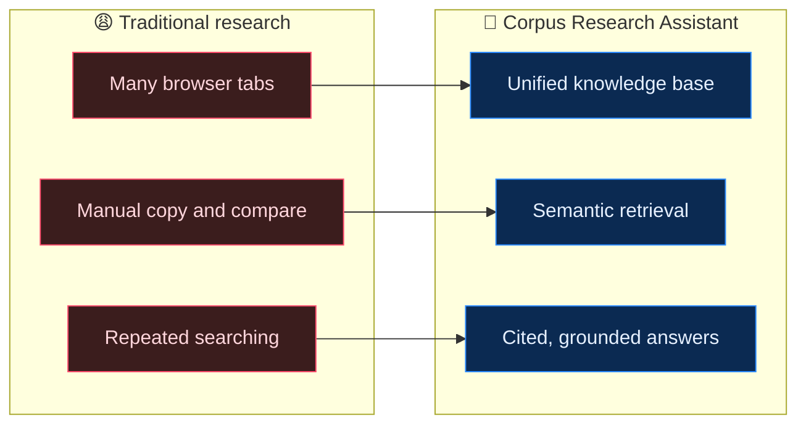

| Challenge | Proposed Solution |
| :--- | :--- |
| Information scattered across multiple URLs | Unified persistent knowledge base |
| Manual content collection | n8n-based ingestion workflow (`Webhook -> HTTP -> HTML Extract`) |
| Difficulty locating relevant passages | Embedding-based semantic retrieval via ChromaDB |
| Unsupported AI-generated answers | Source-grounded generation and explicit fallback |
| Repeated ingestion of existing material | Persistent vector storage and incremental indexing |

---

## ✨ 3. Core Features

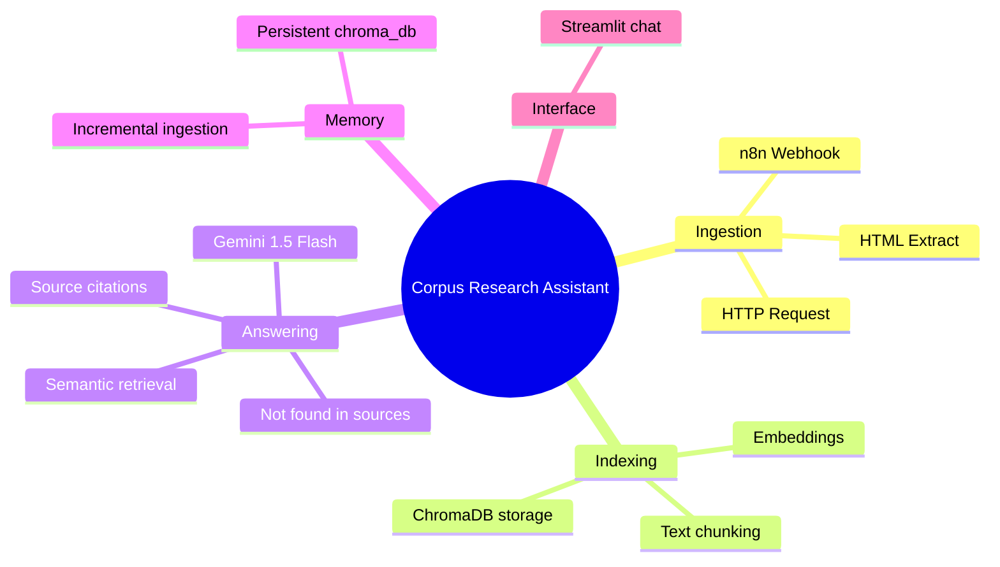

<table>
<tr>
<td width="50%" valign="top">

### 3.1 📥 Automated URL ingestion
The ingestion workflow begins when a user submits one or more URLs to an **n8n webhook**. The workflow is responsible for receiving the URLs, retrieving accessible web content, extracting meaningful text using **HTML extraction nodes**, and preparing it for indexing.

</td>
<td width="50%" valign="top">

### 3.2 🧬 Text chunking and embedding generation
Long web pages are divided into **smaller text chunks**. Each chunk can be retrieved independently, allowing the system to identify specific passages rather than supplying an entire article to the language model. **Embeddings** convert these chunks into numerical vector representations that capture semantic relationships.

</td>
</tr>
<tr>
<td width="50%" valign="top">

### 3.3 💾 Persistent vector database
**ChromaDB** stores the document embeddings together with the associated text and source metadata. The metadata preserves the **originating URL for every chunk** so that retrieved evidence can be traced back to its source.

</td>
<td width="50%" valign="top">

### 3.4 💬 Natural-language question answering
A **Streamlit** interface provides the user-facing research experience. Users can ask questions in ordinary language. The retrieval layer identifies relevant chunks from ChromaDB, and **Google Gemini** uses the retrieved evidence to formulate a readable response.

</td>
</tr>
</table>

### 3.5 🔗 Source citations and grounded answers

Responses identify the URL associated with each relevant piece of evidence. Citations are **derived from retrieved source metadata** rather than generated as unsupported links. When the retrieved context is insufficient, the system explicitly responds: ***"Not found in sources."***

### 🧪 Example queries to try

| Query | Expected behavior |
| :-- | :-- |
| *"What does source A say about topic X?"* | Retrieves matching chunks and answers with the originating URL cited |
| *"Compare what my sources say about X"* | Pulls evidence from several URLs and cites each one |
| *"Ask about something not in any ingested page"* | Replies **Not found in sources.** instead of guessing |
| *Ingest a new URL, then ask again* | New knowledge is added without losing earlier sources |

---

## 🏗️ 4. System Architecture

The architecture consists of **two connected workflows: document ingestion and question answering.**

### 🗺️ End-to-end flow

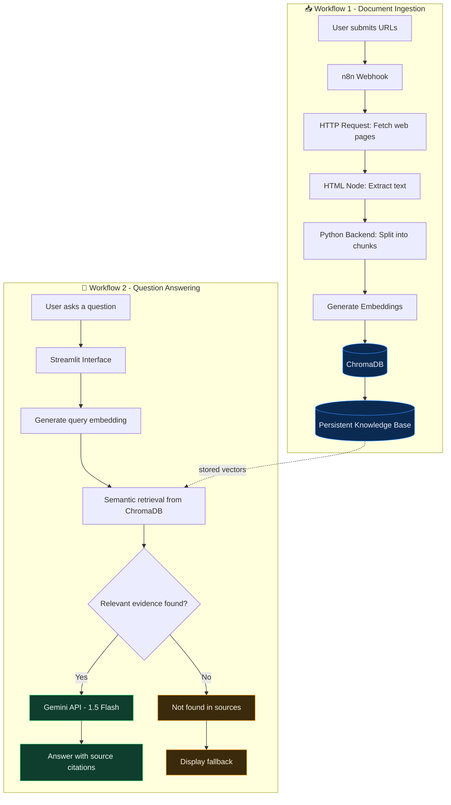

### 📨 Sequence: ingesting a URL

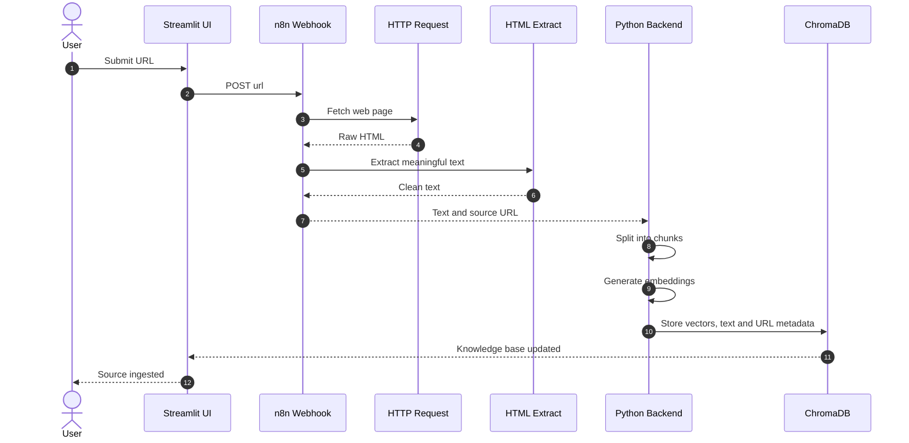

### 💬 Sequence: asking a question

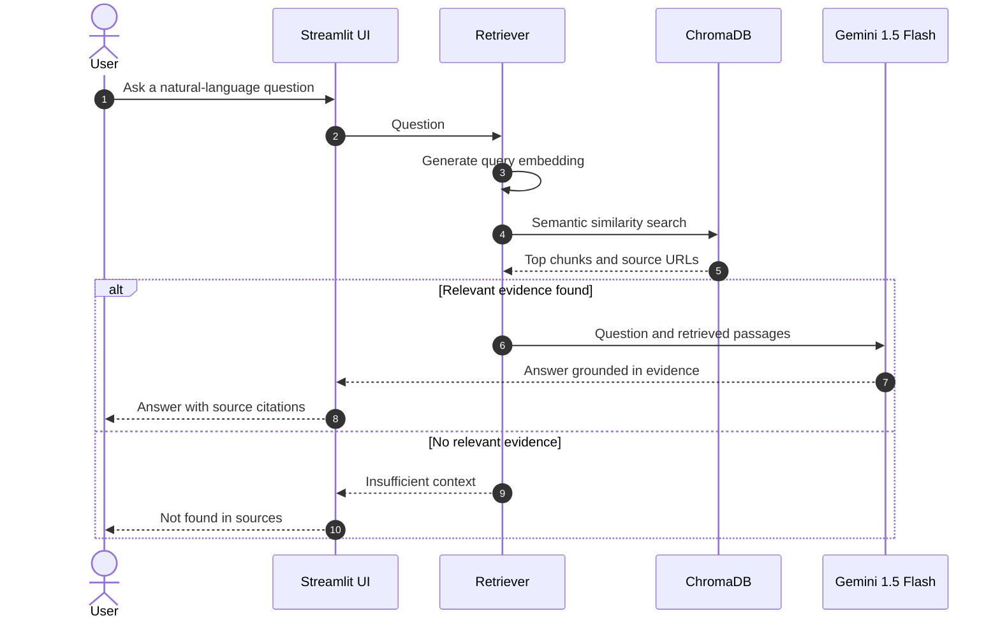

### 🔁 Lifecycle of the knowledge base

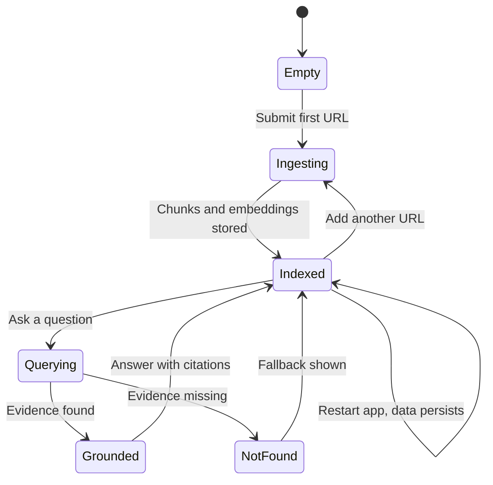

### 🗃️ Conceptual data model

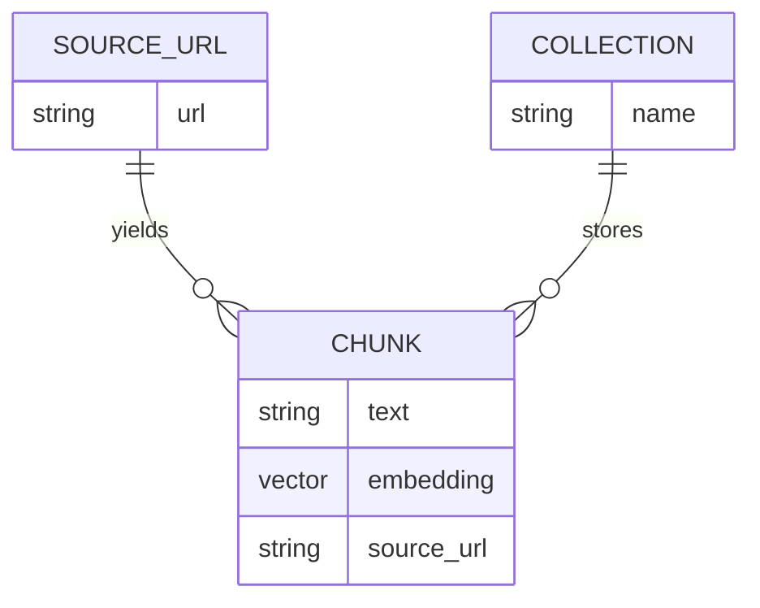

> Every chunk keeps its **original URL as metadata**, which is what makes accurate citations possible.

---

## 🧰 5. Technology Stack

| Layer | Technology | Role |
| :-: | :-- | :-- |
| 🐍 | **Python** | Application logic, backend processing, and RAG pipeline |
| 🔀 | **n8n** | Visual workflow automation, webhook orchestration, and HTML scraping |
| 🧠 | **Gemini API** (`gemini-1.5-flash`) | Context-aware answer generation and fast inference |
| 🗄️ | **ChromaDB** | Local vector storage and similarity search |
| 🎨 | **Streamlit** | Interactive user interface (`app.py`) |
| 🔐 | **python-dotenv** | Environment-based configuration management |

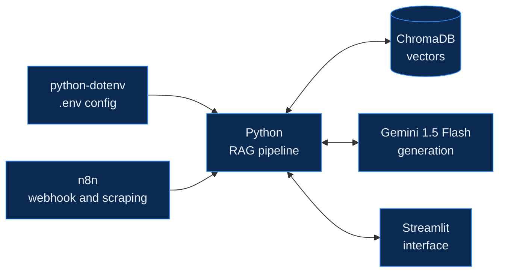

---

## 📂 6. Project Structure

Based on the implemented architecture, the repository is structured as follows:

```plaintext
research-assistant/
│
├── backend/
│   ├── config.py             # Environment & model configuration
│   ├── database.py           # Database connection logic
│   ├── llm_engine.py         # Gemini API integration
│   ├── prompts.py            # System prompts & citation formatting
│   └── retriever.py          # ChromaDB semantic search logic
│
├── frontend/
│   └── app.py                # Streamlit user interface
│
├── chroma_db/                # Persistent local vector database directory
├── n8n/
│   └── workflow.json         # Exported n8n ingestion workflow
│
├── .env                      # API keys (Git ignored)
├── .env.example              # Environment variables template
├── .gitignore                # Security exclusions
├── requirements.txt          # Python dependencies
└── README.md                 # Project documentation
```

### 🧩 How the modules connect

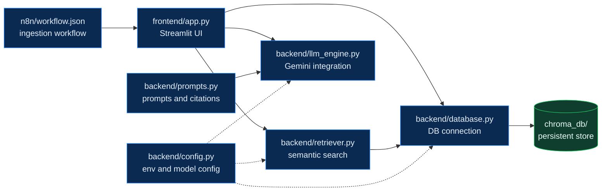

---

## ⚙️ 7. Prerequisites & Environment Configuration

### ✅ Prerequisites

| Requirement | Details |
| :-- | :-- |
| 🐍 **Python** | 3.10+ installed locally |
| 🔀 **n8n** | An active n8n instance (Cloud or Local) |
| 🔑 **Gemini API key** | A Google Gemini API Key |

### 🔐 Environment variables

Create a `.env` file in the root directory based on your `config.py` setup:

```bash
# Gemini AI Configuration
GEMINI_API_KEY=your_gemini_api_key_here

# Database Configuration
CHROMA_DB_PATH=./chroma_db
COLLECTION_NAME=research_assistant
```

| Variable | Description |
| :-- | :-- |
| `GEMINI_API_KEY` | Google Gemini API key used for answer generation |
| `CHROMA_DB_PATH` | Directory of the persistent local ChromaDB store |
| `COLLECTION_NAME` | Name of the ChromaDB collection holding your chunks |

> [!WARNING]
> **Security Note:** Never commit your `.env` file. It is explicitly ignored in the `.gitignore`.

---

## 🚀 8. Installation and Setup

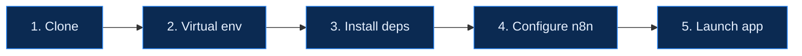

<details open>
<summary><b>1️⃣ Clone the repository</b></summary>

```bash
git clone <your-repository-url>
cd research-assistant
```

</details>

<details open>
<summary><b>2️⃣ Set up the virtual environment</b></summary>

```bash
python -m venv venv
.\venv\Scripts\activate  # Windows
```

On macOS / Linux use `source venv/bin/activate` instead.

</details>

<details open>
<summary><b>3️⃣ Install dependencies</b></summary>

```bash
pip install -r requirements.txt
```

</details>

<details open>
<summary><b>4️⃣ Configure n8n</b></summary>

Import the `workflow.json` into n8n. Ensure the **Webhook URL is active** and the **HTML extraction node is properly linked to your backend ingestion endpoint**.

</details>

<details open>
<summary><b>5️⃣ Launch the application</b></summary>

```bash
streamlit run frontend/app.py
```

</details>

---

## 🛡️ 9. Reliability, Grounding, and Error Handling

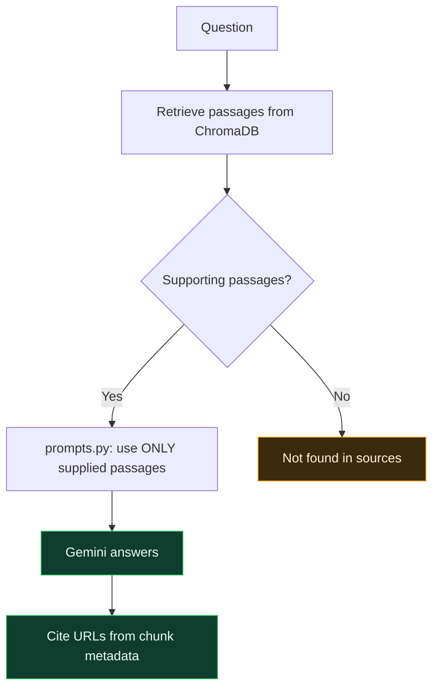

| Safeguard | How it works |
| :-- | :-- |
| 🧾 **Retrieval-grounded generation** | The `prompts.py` file strictly instructs Gemini to use **only supplied passages** as evidence and explicitly acknowledge missing information. |
| 🏷️ **Source metadata integrity** | Every indexed chunk in ChromaDB retains its **original URL as metadata**, ensuring accurate tracing back to the source. |
| 💾 **Persistent storage** | `chroma_db` is stored locally within the project directory, ensuring that data **persists across application and server restarts**. |

---

## 🎓 10. Conclusion

The **Research Assistant With Memory** creates a robust workflow where users can continuously expand their knowledge base and ask questions across previously indexed sources. By utilizing **Gemini's rapid inference**, **n8n's seamless webhooks**, and **ChromaDB's persistent semantic retrieval**, the system prioritizes **grounded, verifiable answers** over AI hallucinations.

---

<div align="center">

**⭐ If you find this project useful, consider giving it a star!**


</div>
